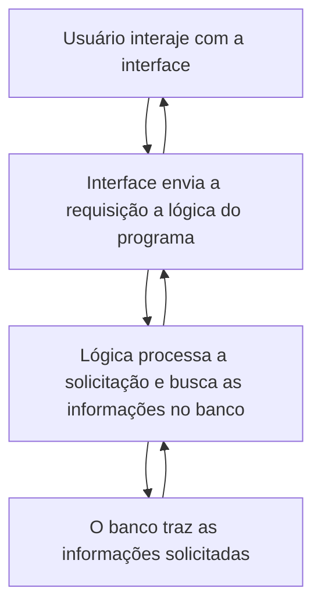
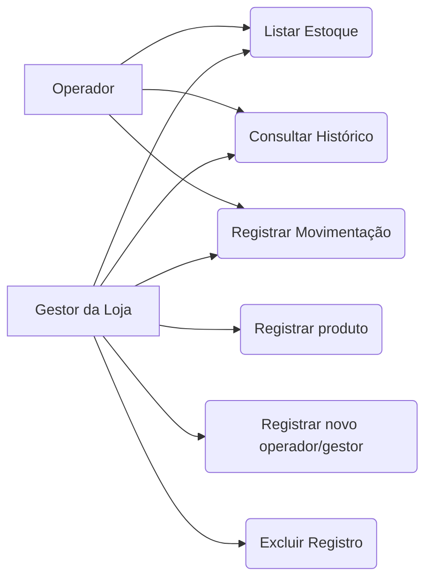

# Documentação da Estruturação do Gerenciador de uma Loja de Instrumentos Musicais  
  
## Sistema de Gerenciamento de uma Loja de Instrumentos Musicais  
  
**Padrão Internacional:** ISO/IEC/IEEE 29148:2018    
**Versão:** 1.0.0    
**Data:** 2026-10-19    
**Autor:** Lucas Combinato Gato & Thayssa Maneo
  
---  
  
## 1. Introdução  
  
### 1.1 Propósito  
  
Este Documento descreve os requisitos e as funcionalidades do projeto final de NEXT em FrontEnd, com o objetivo de:  
* Definir as funcionalidades do sistema;  
* Padronizar o entendimento entre os Stakeholders (Desenvolvedor e Professor/Mediador).  
  
---  
  
### 1.2 Escopo  
  
O Sistema permitirá:  
* Controle geral do estoque (CRUD);   
* Registro de novos produtos ao estoque;  
* Registro de vendas;
* Visualização dos históricos de movimentações;
* Controle de acesso de diferentes cargos.
  
O sistema será uma aplicação web utilizando:  
* HTML (Estrutura organizada)  
* CSS (Visualização legível e estilizada)  
* JS (Lógica de backend e processamento)  
* NEXT (Framework de auxílio geral a implementação de funcionalidades extras ao código de forma mais fácil)  
* MongoDB (Persistência de dados BD NoSQL)
* Arquitetura baseada em CRUD (Create, Read, Update, Delete) com arquivos separados.  
 #### 
 Objetivos:  
* Permitir que o usuário possa reorganizar os produtos do sistema (Create, Update e Delete);  
* Permitir uma visualização interativa e dinâmica dos dados (Read);  
* Garantir uma boa organização de informações e alterações de forma profissional.  
  
---  
  
### 1.3 Definições e Acrônimos  
 #### 
 Tabela de Termos e Definições  
| Termos | Definições |  
| :--- | :--- |  
| Produto | Item gerenciado pelo estoque |  
| Registro / Entrada | Inclusão de um novo produto ou incremento de saldo no estoque |  
| Venda / Saída | Registro de saída de um produto |  
| Estoque | Quantidade física disponível de cada produto |  
| CRUD | Operações básicas de banco de dados: Criação, Leitura, Atualização e Exclusão |  
 #### 
 Lista de Acrônimos  
* **RF:** Requisitos Funcionais;  
* **RNF:** Requisitos Não Funcionais;  
* **UC:** Casos de Uso;  
* **CA:** Critérios de Aceitação;  
* **BD:** Banco de Dados;  
* **NoSQL:** *No Structured Query Language* (Linguagem de Consulta Não Estruturada);  
  
---  
  
### 1.4 Visão Geral do Documento  
  
Este Documento está Organizado em:  
* Introdução;
* Escopo;  
* Definição de Acrônimos;
* Índice;
* Descrição do sistema;
* Arquitetura do Sistema;
* Organização do Sistema (Lógica);
* Requisitos do Sistema;
* Controle das Versões;
  
Descrição Geral do Sistema e Arquitetura de Páginas;  
* Estrutura do Banco de Dados (NoSQL);  
* Requisitos Detalhados (Funcionais mapeados ao CRUD e Não Funcionais);  
* Modelos e Diagramas do Sistema (UML/Mermaid);  
* Diretrizes de Organização e Autoavaliação.  

---  
  
## 2. Descrição Geral do Sistema  
  
### 2.1 Perspectiva do Sistema  
  
O sistema é uma aplicação web baseada em scripts JS que interagem com um Banco de Dados MongoDB, renderizando páginas HTML/CSS dinâmicas para o usuário. Além disso, o projeto segue uma arquitetura MVC (Model, View, Controller).



### 2.2 Arquitetura de Páginas e Estrutura de Arquivos` 
Conforme o planejamento estruturado do sistema, a aplicação será dividida nos seguintes arquivos e responsabilidades:  
* **exibirProdutos.js:** Página que exibe todos os produtos de forma listada.  
* **login.js:** Página para Gestores e Operadores se registrarem para executar as ações necessárias.  
* **cadastroProdutos.js:** Página para a criação de um novo produto ao estoque.  
* **cadastroMovimentacao:** Página para a criação de uma nova movimentação, alterando a quantidade de produtos registrados no estoque.  
* **criarContaOperador:** Página em que o Gestor cria uma nova conta de um Operador.
* **exibirMovimentacao:** Página para mostrar a lista das movimentações efetuadas pelo Gestor.  
  
### 2.3 Classes de Usuários  
| Usuário | Descrição |  
| --- | --- |
| Gestor | Perfil responsável por registrar novas Movimentações, produtos, Operadores e exclusão de Produtos. |  
| Operador | Perfil responsável apenas para registrar Movimentações. |
  
### 2.4 Ambiente Operacional  
- **Cliente:** Navegadores modernos com suporte a renderização de HTML5 e CSS3 (Chrome, Edge, Firefox, Brave, Safari);
  
### 2.5 Suposições  
- O usuário possui conhecimento básico de navegação web;
- O banco de dados MongoDB está ativo e aceitando conexões na porta padrão.
  
### 2.6 Instalação e Execução  
###        depois #######################################
  
### 3.0 Estruturamento dos dados
| PRODUTOS | USUÁRIOS | MOVIMENTAÇÕES |
| --- | --- | --- |
| _id | _id | _id |
| nomeProduto | nome | idProduto |
| categoria | email | idUsuario |
| quantidade | senha | dateTime |
| preco | tipo | tipo |

---

## 4. Requisitos do Sistema  
### **4.1 Requisitos Funcionais (Mapeados ao CRUD)**  

---

| ID | TÍTULO | DESCRIÇÃO |
| --- | --- | --- |
| RF-01 | Cadastro de Novos Produtos (CREATE) | Permitir o registro de novos produtos no estoque através de um formulário. |
| RF-02 | Listagem Dinâmica de Produtos (READ) | Exibir de forma interativa e organizada os produtos cadastrados no sistema. |
| RF-03 | Exclusão Segura de Produtos (DELETE) | Permitir a remoção de um produto do sistema de forma segura. |
| RF-04 | Registro de Vendas | Permitir o registro das movimentações dos produtos. |
| RF-05 | Histórico de Movimentações | Permitir a visualização do histórico de movimentações de produtos ocorridas no sistema. |

### **4.2 Requisitos Não Funcionais (RNF)**

| ID | TÍTULO | DESCRIÇÃO |
| --- | --- | --- |
| RNF-01 | Usabilidade e Estética | O sistema deve seguir exatamente a organização estrutural e a paleta de cores planejada no Stitch. |
| RNF-02 | Organização de Código e Arquitetura Profissional | O sistema deve seguir o princípio de profissionalização exigido, mantendo arquivos separados por responsabilidades, uso de código comentado para explicação de fluxos. |
| RNF-03 | Confiabilidade e Responsabilidade com Dados | Tratamento correto de exclusões e atualizações utilizando identificadores únicos (IDs) e prevenção de falhas de comunicação com o MongoDB.
---

## **5. Regras de Negócio (RN)**

| ID | TÍTULO | DESCRIÇÃO |
| --- | --- | --- |
| RN-01 | Validação de Preço | O valor de venda de um produto não pode ser menor ou igual a R$ 0,00. O sistema deve rejeitar entradas inválidas. |
| RN-02 | Validação de Estoque | A quantidade de itens em estoque nunca pode assumir valores negativos (menores que 0). |
| RN-03 | Consistência de Venda | Não é permitido realizar a movimentação de um produto se a quantidade solicitada for maior do que a quantidade atualmente disponível em estoque. |
| RN-04 | Rastreabilidade | Toda venda efetuada com sucesso deve obrigatoriamente gerar um registro correspondente na listagem de histórico de movimentações. |
| RN-05 | Dashboards (Bônus) | O dashboard de estatísticas deve permanecer sempre atualizado de acordo com as novas movimentações. |

## 6. Modelos do Sistema (Diagramas)
### 6.1 Diagrama de Casos de Uso
Mapeamento do que o usuário pode realizar no sistema de gerenciamento a partir das telas planejadas.



### 6.2 Diagrama de Sequência (Fluxo de Exclusão Segura - Exemplo `DELETE`)
Demonstração prática da responsabilidade com dados e interações descritas na Etapa 7 do projeto integrado.
```mermaid
sequenceDiagram  
    
```
    depois

## 7. Controle de Versões
### 7.1 Histórico de Alterações / função
| Versão | Horário | Autor | Modificação |
| --- | --- | --- | --- |
| 1.0.0 branch [documentacao] | 11:30 | Lucas Combinato Gato | Versão final: Definição da Documentação geral do projeto (requisitos, pages, nomoe do projeto, etc.) |
| 1.0.0 | 11:30 | Thayssa Maneo | Versão Final: Criou todos os prótótipos no Sticth e planejou as páginas. |
